# TripTales — Personal Travel Memory Organizer

**TripTales** is a personal travel memory organizer developed for **Mobile Communication — ICA 03**. The application brings trip details, travel journals, expenses, and photographs together in one place, helping users keep a record of their journeys.

Built with **React Native, Expo, and TypeScript**, TripTales uses **SQLite** to store travel information locally on the device. The interface has five main tabs: Home, Trips, Journal, Expenses, and Memories.

## Main Features

| Section | What you can do |
| --- | --- |
| **Home** | View a travel overview, recent adventures, and quick links to the main features. |
| **Trips** | Browse trips, search destinations, filter by category, and add, edit, or delete trips. |
| **Journal** | Write and manage journal entries connected to individual trips. |
| **Expenses** | Record expenses by trip and category, and review spending totals and breakdowns. |
| **Memories** | Save travel photographs with captions and open images in a full-screen viewer. |

Trip categories include **Nature, Historical, Adventure, Beach, City, and Other**. The project also contains sample trips and destination photographs from locations across Sri Lanka for demonstration.

## Application Screenshots

The screenshots below were captured from the application. More views are available in the [`screenshots/`](screenshots/) directory.

### Home Dashboard

The Home screen brings together trip statistics, recent adventures, and quick access to the other sections.

| Welcome and overview | Travel statistics | Recent adventures | Quick access |
| :---: | :---: | :---: | :---: |
| 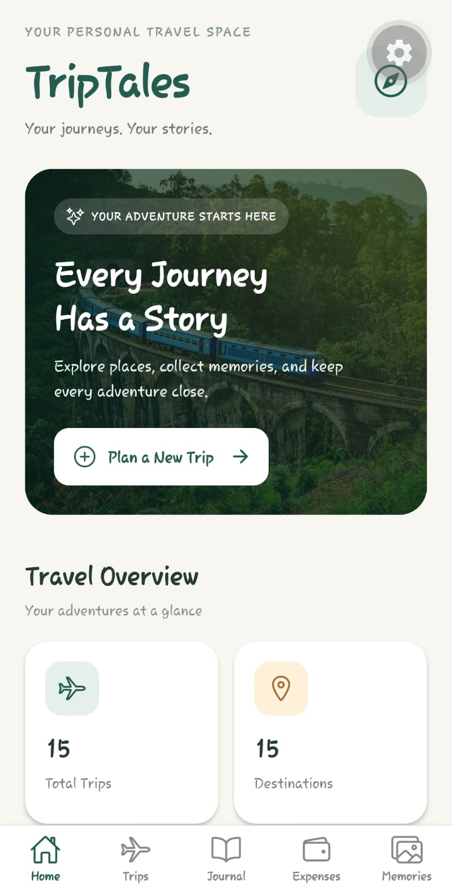 | 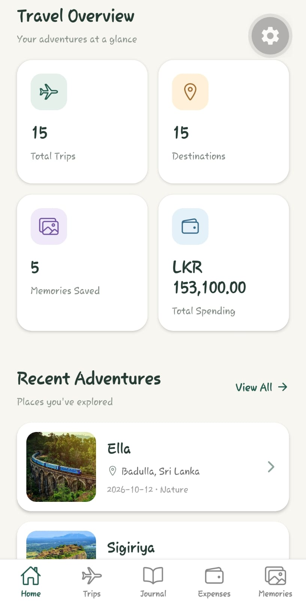 | 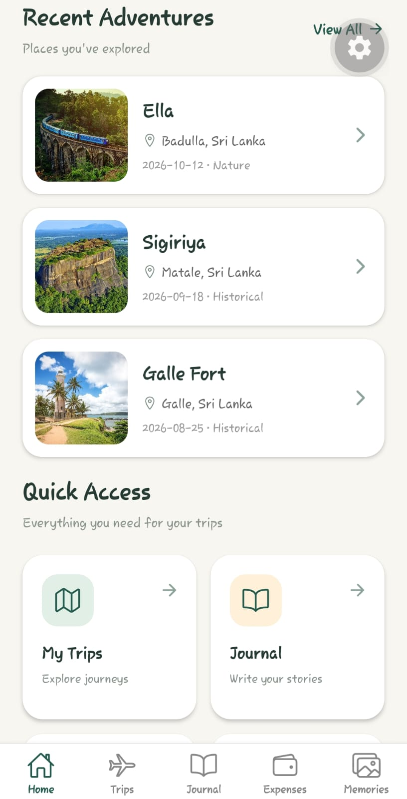 | 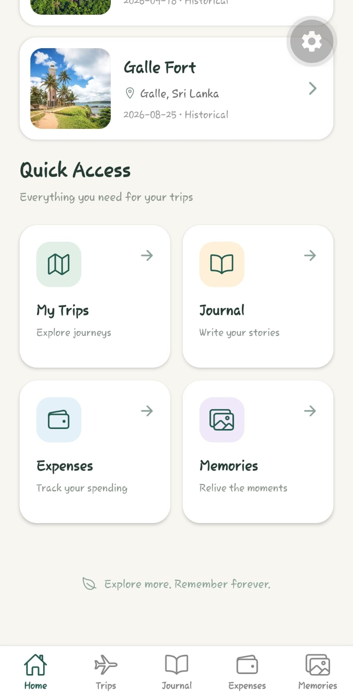 |

### Trip Management

Users can explore their saved trips, filter and search destinations, view trip details, and create or edit records.

| Trips | Trip details | Search by category | Search by destination |
| :---: | :---: | :---: | :---: |
| 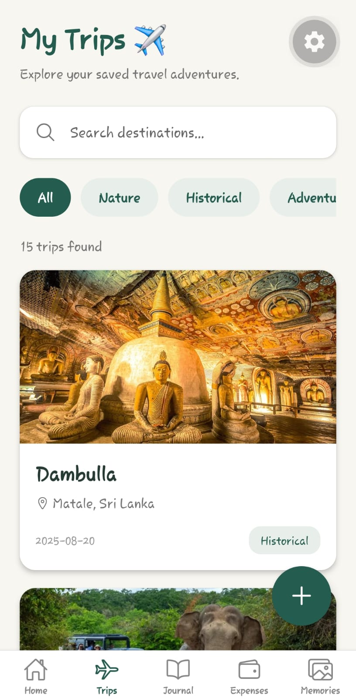 | 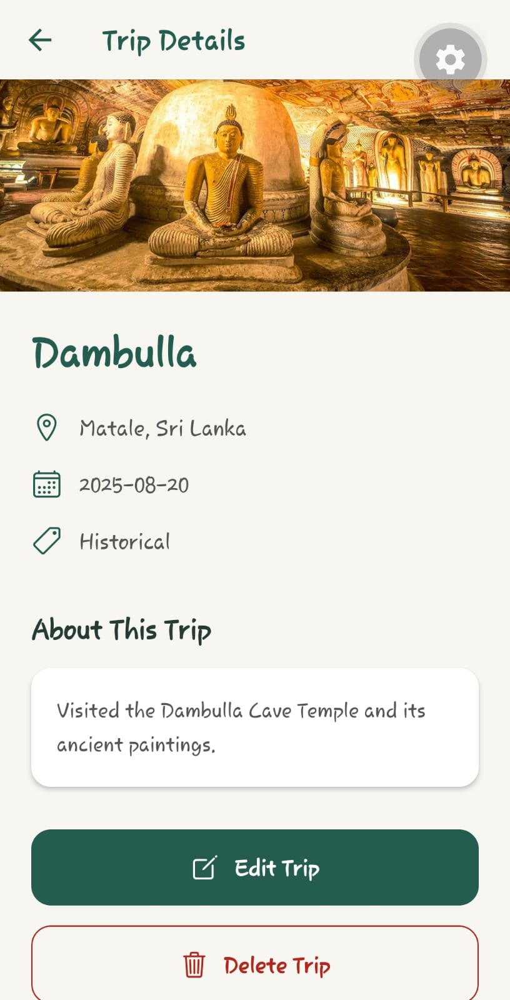 | 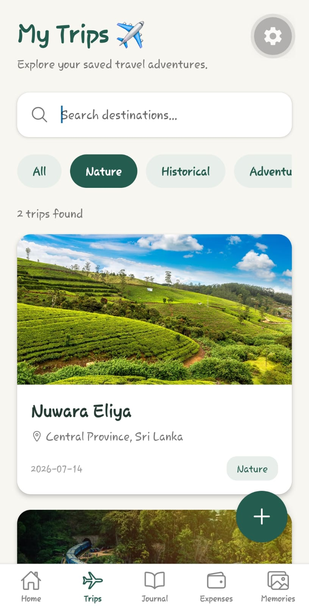 | 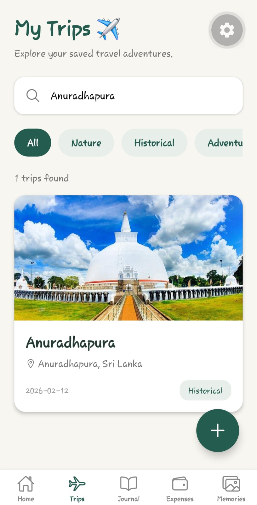 |

| Add trip — first section | Add trip — remaining fields | Edit trip |
| :---: | :---: | :---: |
| 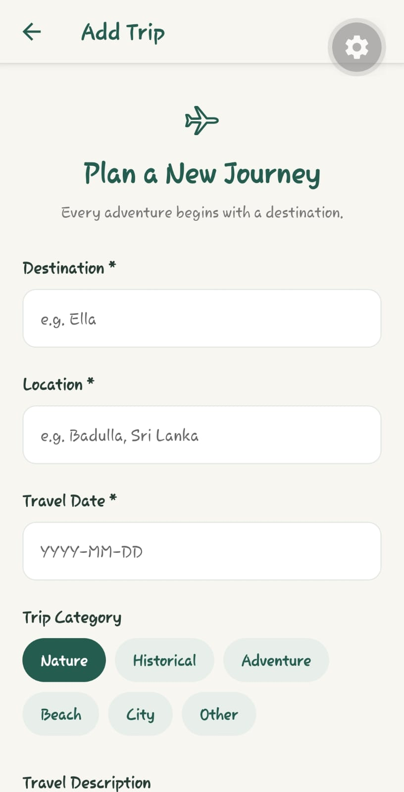 | 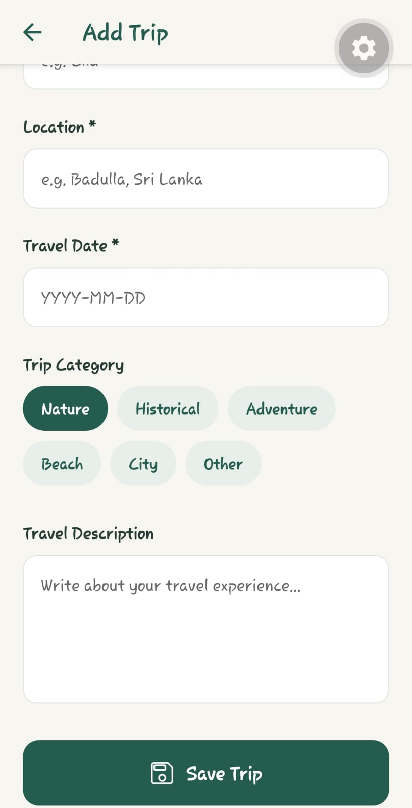 | 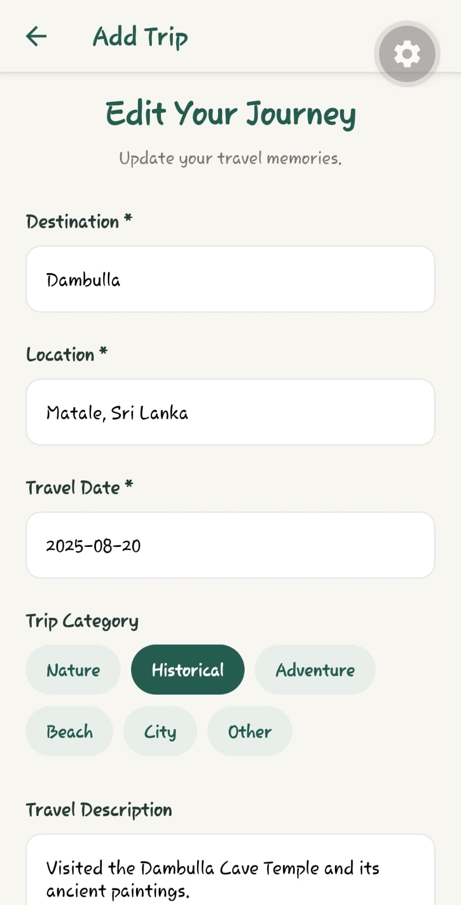 |

### Travel Journal

Journal entries let users record their experiences and associate each entry with a trip.

| Journal entries | New journal entry |
| :---: | :---: |
| 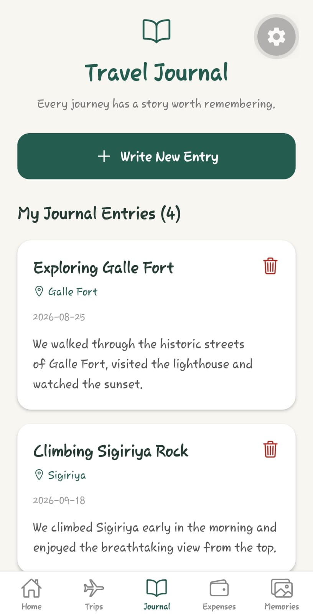 | 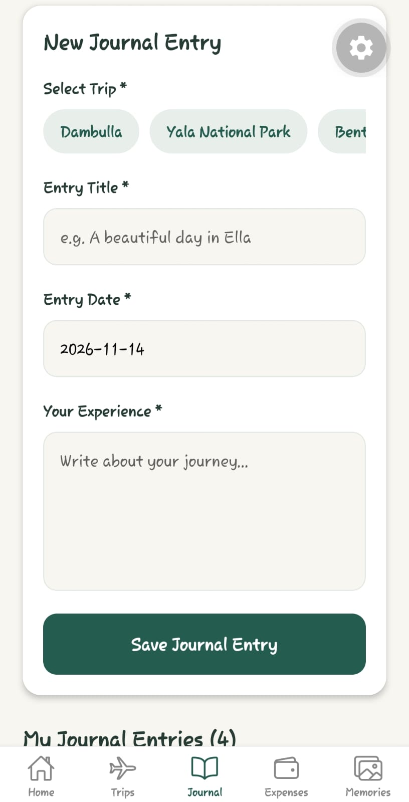 |

### Expense Tracking

Expenses are grouped by trip and can be organized into categories such as transport, food, accommodation, activities, shopping, and other spending.

| Expense overview | Expenses by trip | New expense |
| :---: | :---: | :---: |
| 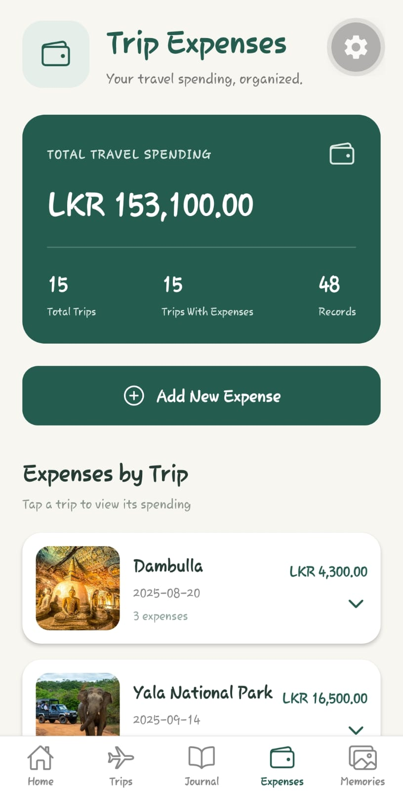 | 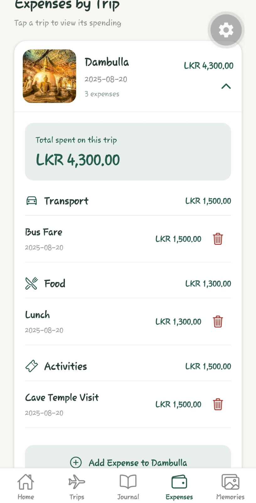 | 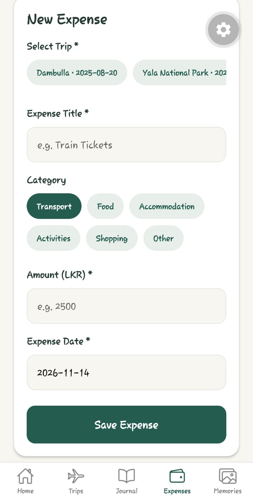 |

### Photo Memories

Users can save a photograph with a caption for a trip and view saved photos in full screen.

| Memory gallery | New memory | Full-screen photo |
| :---: | :---: | :---: |
| 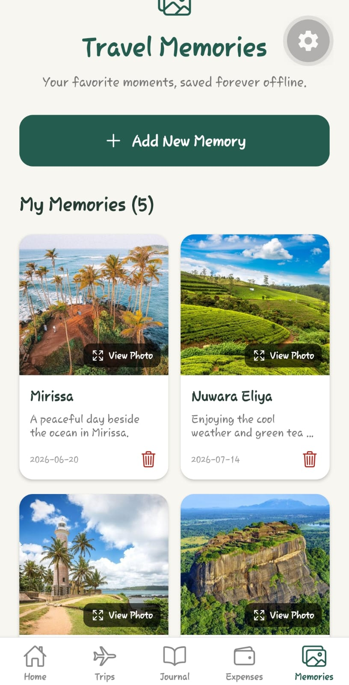 | 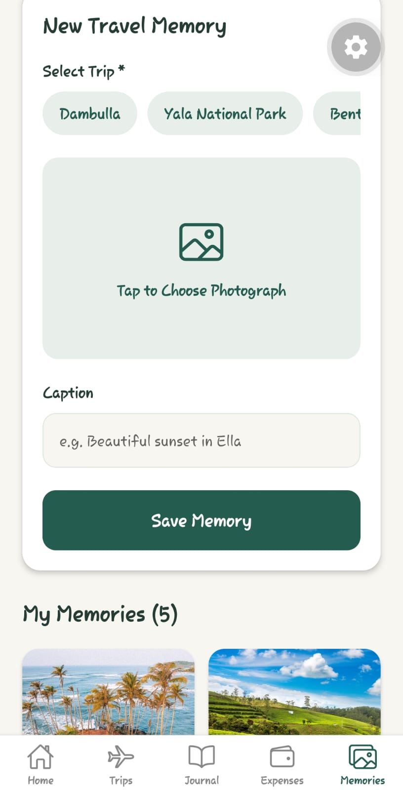 |  |

## Technologies Used

| Technology | Purpose |
| --- | --- |
| **React Native** | Mobile application interface |
| **Expo** | Development and running the application |
| **TypeScript** | Type-safe application code |
| **Expo SQLite** | Local database storage |
| **React Navigation** | Bottom-tab and stack navigation |

## Project Structure

```text
TripTales/
├── assets/                   # App icons, splash assets and destination images
│   └── destinations/
├── screenshots/              # Screenshots of the application
├── src/
│   ├── data/                 # Demo data and destination image references
│   ├── database/             # SQLite setup and data operations
│   ├── navigation/           # Tab and stack navigation
│   └── screens/              # Application screens
├── App.tsx                   # Main application component
├── app.json                  # Expo configuration
├── package.json              # Dependencies and scripts
├── tsconfig.json             # TypeScript configuration
└── README.md                 # Project documentation
```

Additional files and folders may be present depending on the Expo project configuration.

## Getting Started

### Prerequisites

- **Node.js** and npm
- **Git** (to clone the repository)
- **Expo Go** on a compatible Android or iOS device
- A code editor such as Visual Studio Code (optional)

### Installation

**1. Clone the repository**

```bash
git clone https://github.com/aarabyselvaratnam/TripTales.git
```

**2. Open the project folder**

```bash
cd TripTales
```

**3. Install dependencies**

```bash
npm install
```

**4. Start Expo**

```bash
npx expo start
```

**5. Open the app on your phone**

Open Expo Go and scan the QR code displayed by Expo. For a LAN connection, the phone and computer should be on the same Wi-Fi network.

If the local connection is unavailable, try tunnel mode:

```bash
npx expo start --tunnel
```

Expo may require sign-in or additional setup for tunnel mode.

> **Platform note:** TripTales is intended primarily for Android and iOS devices. Its SQLite-based features should be tested on a mobile device; some database operations may not be supported in the browser without further changes.

## Local Data Storage

TripTales stores four main types of records in **SQLite**:

1. **Trips** — destinations, locations, dates, categories, and descriptions.
2. **Journal entries** — written travel experiences associated with trips.
3. **Expenses** — spending records linked to trips and expense categories.
4. **Memories** — travel photographs and captions associated with trips.

The database is initialized when the app starts, and demonstration data is included to make the features easier to explore. Information is stored locally rather than in a cloud account. Clearing the app's data or uninstalling it may remove saved records.

## Project Information

- **Project:** TripTales — Personal Travel Memory Organizer
- **Module:** Mobile Communication
- **Assessment:** ICA 03
- **Application type:** React Native mobile application
- **Repository:** [TripTales on GitHub](https://github.com/aarabyselvaratnam/TripTales)

This project provided practical experience with React Native screen development, navigation, local SQLite data management, image handling, and organizing a mobile application into separate functional modules.
